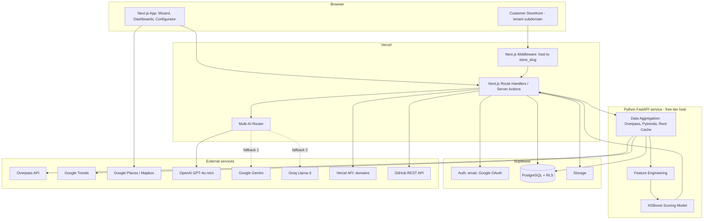
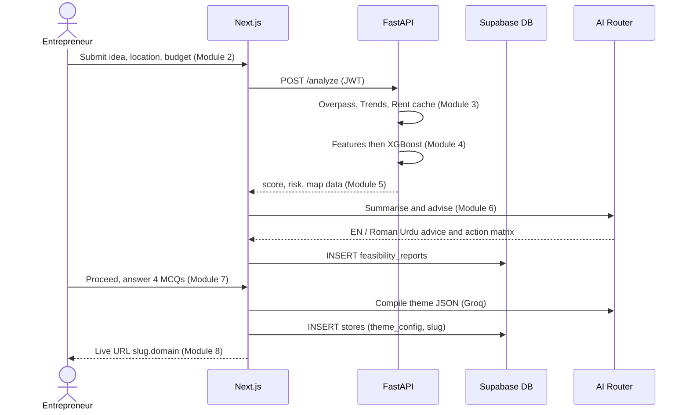
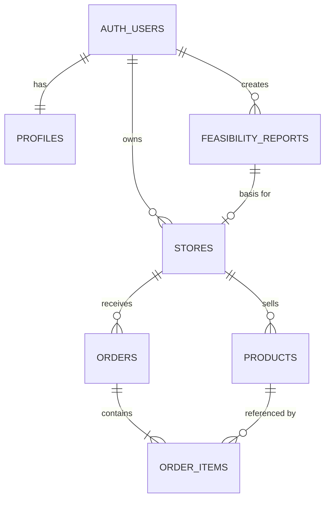
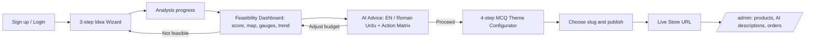

# Software Requirements Specification (Revised)

## AI-Powered E-Commerce Feasibility Advisor & Auto Store Generator

| Field | Value |
| --- | --- |
| Version | 2.0 (supersedes v1.0, April 2026) |
| Author | Muhammad Arslan, FAL23-BCS-030 |
| Programme | BS Computer Science, Final Year Project, COMSATS University Islamabad |
| Standard | Structured after IEEE 830 / ISO/IEC/IEEE 29148 |

### Revision summary (v1.0 → v2.0)

| Area | v1.0 draft | v2.0 decision | Reason |
| --- | --- | --- | --- |
| Market | Global, USD only | Pakistan-first, PKR default, USD toggle | Matches the target SME market |
| Roles | User / Manager / Admin | Entrepreneur (store owner) / Admin (Manager role dropped) | The 8 modules have no manager approval step |
| Store generation | Generates separate frontend, backend and DB per store | One shared multi-tenant app and single DB, isolated by RLS | Fits Rs. 0–15,000 budget; far simpler to operate |
| Backend | Supabase plus Python microservice | Supabase (DB/Auth) + FastAPI (ML and spatial) | Same, but responsibilities now explicit |
| Competitor data | Google Maps API | OpenStreetMap Overpass (10–15 km) | Zero cost |
| LLM | OpenAI only | Fallback chain: GPT-4o-mini → Gemini → Groq Llama-3 | Fault tolerance |
| Theming | Template chosen by category | 4-step MCQ configurator compiled to JSON theme | Code-free customisation |
| Payments | Stripe/PayPal | Cash on Delivery (COD) in v1; local gateways listed as future work | Stripe is not generally available for Pakistani merchants |
| Hosting | AWS / Netlify / Railway | Vercel + Supabase free tier + free-tier Python host | Zero-cost constraint |
| Legal | GDPR-aware | Pakistan context (see §2.4) | Local compliance |

---

## 1. Executive Summary & Project Purpose

### 1.1 Purpose

This document specifies the requirements of **AI-Powered E-Commerce Feasibility Advisor & Auto Store Generator**, a SaaS platform for Pakistani SMEs and first-time entrepreneurs. It is written for supervisors, developers, testers and evaluators.

### 1.2 Problem

Small entrepreneurs in Pakistan open online or physical stores without evidence on competition, rent, demand or budget fit, and then need developers to build a store. Both steps are costly and error-prone.

### 1.3 Solution

The platform performs two linked jobs:

1. **Decision engine.** From a business idea, location and budget it aggregates open data (competitors, rent, search trends), scores feasibility with XGBoost (0.00–1.00 plus risk level), and explains the result with an LLM advisor in English or Roman Urdu.
2. **Execution engine.** If the owner proceeds, a code-free MCQ wizard produces a theme configuration, and the platform deploys a live multi-tenant storefront with SEO and an admin dashboard.

### 1.4 Objectives

- O1: Feasibility result in ≤ 15 s for a typical request (see NFR-P1).
- O2: A store goes from wizard completion to live URL in ≤ 3 minutes.
- O3: Total operating cost within Rs. 0–15,000 for the project lifetime.
- O4: No single AI provider outage blocks the advisory flow.

### 1.5 Definitions

| Term | Meaning |
| --- | --- |
| Tenant | One store owner and their store, isolated in the shared DB |
| RLS | PostgreSQL Row-Level Security |
| POI | Point of Interest (competitor business) from OpenStreetMap |
| Saturation Index | Competitor density relative to area and population proxy |
| Theme JSON | Validated JSON produced by Module 7 describing a store's look |
| Overpass | Read-only query API for OpenStreetMap data |

---

## 2. Scope & Geographical Constraints

### 2.1 In scope

All 8 modules in §4, the schema in §5, and the NFRs in §6.

### 2.2 Out of scope (v2.0)

Online payment gateways, native mobile apps, multi-language storefronts beyond English/Roman Urdu advisory text, courier-API integrations, and marketplace-style cross-store search.

### 2.3 Geographical constraints (Pakistan focus)

| ID | Constraint |
| --- | --- |
| GEO-1 | Location input is restricted to Pakistani cities/areas; the map is bounded to Pakistan's extent. |
| GEO-2 | Default currency is PKR; USD is a display toggle using a configurable rate stored in Supabase. |
| GEO-3 | Commercial hubs (e.g., Blue Area, Liberty Market, Saddar, Anarkali, Clifton) are offered as pre-seeded picks alongside map search. |
| GEO-4 | Rent data is sparse and informal. Rent figures are **estimates** from a cached scrape and are labelled with source date and confidence. |
| GEO-5 | Payments in generated stores default to Cash on Delivery, the dominant local method. |

### 2.4 Legal and data notes

- Personal data handling shall follow the Pakistan Personal Data Protection legislation as in force at submission time; this must be re-verified before final submission because the law was still evolving. Data minimisation and user-deletion support are built in regardless.
- Scraped rent listings must respect each source's terms of use and robots rules; only aggregated per-area figures are stored, never raw listings with contact details.
- OpenStreetMap data requires attribution: "© OpenStreetMap contributors" shall be shown on every map.

### 2.5 Assumptions

Users have internet access and a modern browser; free tiers of Vercel, Supabase and the LLM providers remain available; the supervisor accepts open-data estimates in place of paid datasets.

---

## 3. Overall System Architecture & Data Flow

### 3.1 Logical architecture



### 3.2 End-to-end flow (decision → execution)



### 3.3 Multi-tenant request flow

1. A customer visits `slug.<root-domain>`.
2. Next.js middleware reads the `Host` header, extracts `slug`, and rewrites the request to `/_stores/[slug]/...`.
3. The server component loads the store row by slug (public read policy for `status = 'published'`), applies `theme_config`, and renders pages.
4. Store owners reach `/admin` on the same host; Supabase Auth plus RLS ensure that `auth.uid() = stores.owner_id` for every read/write.
5. Unknown or unpublished slugs return a branded 404.

> **Architecture risk to resolve early (important).** A single Vercel deployment can serve wildcard subdomains only under a domain you control (e.g., `*.yourproject.pk` or `*.yourproject.com`). Per-store `store-slug.vercel.app` hostnames cannot be created from one deployment; they would require one Vercel project per store, which hits free-plan project limits quickly. Recommended design: **use one inexpensive root domain with a wildcard record** for free-tier stores (cost is a domain, well inside the budget), and treat "custom domain upgrade" as attaching the owner's own domain to the same project via the Vercel Domains API. Also confirm Vercel's current plan terms: the free Hobby plan is intended for non-commercial use, which is acceptable for an FYP demo but should be stated if the product is ever commercialised. Verify both points against current Vercel documentation before locking the design.

---

## 4. Functional Requirements

Priority: **M** = Must, **S** = Should, **C** = Could.

### Module 1: User Authentication & RBAC Engine

| ID | Requirement | Pri |
| --- | --- | --- |
| FR-1.1 | Register/login with email+password via Supabase Auth; password hashing is delegated to Supabase (no custom hashing code). | M |
| FR-1.2 | Google OAuth sign-in; account linking when the same verified email exists. | M |
| FR-1.3 | Roles: `owner` (default) and `admin`, stored in `profiles.role`; role changes only by admin. | M |
| FR-1.4 | Route guards in Next.js middleware plus RLS as the authoritative check (frontend checks are convenience only). | M |
| FR-1.5 | A seed admin account is created by a migration script reading email and password from **environment secrets**, flagged `must_change_password`. The address `admin@system.com` may be the seed identity, but its password shall never be committed to source or documentation. | M |
| FR-1.6 | **System GitHub REST Sync:** an admin-triggered job uses the GitHub REST API (token in env) to push a versioned JSON export of system configuration (seed data, scoring thresholds, theme presets, rent-cache snapshot) to a repository, with commit message and timestamp logged. No user PII or secrets are ever exported. | S |
| FR-1.7 | Password reset by email; session refresh; sign-out everywhere. | S |
| FR-1.8 | Users can delete their account; owned stores and reports are deleted via cascade. | S |

### Module 2: Business Idea Input & Location Wizard

| ID | Requirement | Pri |
| --- | --- | --- |
| FR-2.1 | Three-step wizard: (1) idea and category, (2) location, (3) budget and options; progress is saved as a draft after each step. | M |
| FR-2.2 | Step 1: category from a predefined list plus free-text product description. | M |
| FR-2.3 | Step 2: location through Google Places or Mapbox autocomplete restricted to Pakistan, plus a **Commercial Hub picker** of seeded hubs per city; resolves to `lat`, `lng`, `city`, `area`. | M |
| FR-2.4 | Step 3: budget with PKR/USD toggle; the canonical stored value is PKR. Validation range e.g. Rs. 10,000–50,000,000, with clear errors. | M |
| FR-2.5 | Optional inputs: business model (online only / physical + online), target audience, planned shop size in sq. ft. | S |
| FR-2.6 | Submission creates a `feasibility_reports` row with status `pending` and starts the analysis. | M |
| FR-2.7 | Search radius defaults to 10 km and is selectable up to 15 km. | S |

### Module 3: Smart Data Aggregation

| ID | Requirement | Pri |
| --- | --- | --- |
| FR-3.1 | Query OpenStreetMap Overpass for POIs matching the category tag mapping within the chosen radius (10–15 km); return name, coordinates, tags, distance. | M |
| FR-3.2 | Overpass requests use timeouts, a retry with backoff, and an alternate public Overpass endpoint on failure. Results are cached per (category, area, radius) for 7 days. | M |
| FR-3.3 | **Rent cache:** a scheduled scraper stores average commercial rent per sq. ft. by city/area in `rent_cache` with `source`, `sample_size`, `scraped_at`. Requests read only from the cache, never scrape live. | M |
| FR-3.4 | If no rent record exists for an area, fall back to the nearest area or city average and mark `confidence = low`. | M |
| FR-3.5 | Google Trends via Pytrends: 12-month interest series for the category, region = PK. Pytrends is unofficial, so failures fall back to the last cached series and set a `stale` flag. | M |
| FR-3.6 | Aggregation returns a single typed payload to Module 4 and records data-source health in the report. | M |

### Module 4: Feature Engineering & XGBoost Feasibility Scoring

| ID | Requirement | Pri |
| --- | --- | --- |
| FR-4.1 | Compute features: `competitor_count`, `competitor_density_per_km2`, `avg_competitor_rating`, `rent_per_sqft`, `estimated_monthly_rent`, `rent_to_budget_ratio`, `budget_to_setup_cost_ratio`, `demand_score` (normalised trend index), `trend_slope`, `saturation_index`. | M |
| FR-4.2 | Missing values are imputed with documented defaults and counted in `data_quality_score`. | M |
| FR-4.3 | XGBoost model outputs a continuous `feasibility_score` in \[0.00, 1.00\], rounded to two decimals. | M |
| FR-4.4 | Risk level mapping: ≥ 0.75 Low risk; 0.55–0.74 Moderate; 0.35–0.54 High; \< 0.35 Critical. | M |
| FR-4.5 | The model artifact is versioned; each report stores `model_version`. | M |
| FR-4.6 | Return the top feature contributions (e.g., SHAP or XGBoost gain) so the advisor can explain the score. | S |
| FR-4.7 | Training data provenance shall be documented (public datasets, expert-labelled or rule-synthesised samples). Because the dataset is partly synthetic, the report must display "Estimate based on a model trained on limited data", and evaluation metrics (MAE/RMSE, cross-validation) are reported in the thesis. | M |

### Module 5: Competition, Location & Interactive Rent Map Engine

| ID | Requirement | Pri |
| --- | --- | --- |
| FR-5.1 | Interactive map (Leaflet with OSM tiles, or Google Maps) with competitor markers, radius circle, and popups (name, distance, rating if available). | M |
| FR-5.2 | Rent overlay: area-level rent shown as colour-coded zones or markers. | S |
| FR-5.3 | **Rent-to-Budget gauge:** estimated monthly rent ÷ monthly-equivalent budget share, with green/amber/red bands. | M |
| FR-5.4 | **Saturation Index meter** (0–100) with band labels (Underserved / Balanced / Crowded / Saturated). | M |
| FR-5.5 | 12-month trend line chart for the category. | M |
| FR-5.6 | Competitor table with sort/filter and CSV export. | S |
| FR-5.7 | OSM attribution displayed on the map. | M |

### Module 6: Multi-AI Advisory, Risk Engine & Action Matrix

| ID | Requirement | Pri |
| --- | --- | --- |
| FR-6.1 | **AI router** tries providers in order: OpenAI GPT-4o-mini → Google Gemini → Groq Llama-3; model names are configuration values, not hard-coded, because provider model lines are retired over time. | M |
| FR-6.2 | Failover triggers: HTTP 429/5xx, timeout (default 20 s), malformed or schema-invalid output. Each attempt is logged in `ai_call_log`. | M |
| FR-6.3 | If all providers fail, return a **deterministic rule-based summary** built from scores and thresholds so the dashboard is never empty. | M |
| FR-6.4 | Output language switch: English / Roman Urdu; the same structured facts are passed to the LLM in both cases, and results are cached per language. | M |
| FR-6.5 | The LLM receives only computed facts (scores, ratios, counts) and is instructed not to invent numbers; outputs are returned as validated JSON. | M |
| FR-6.6 | **Risk engine:** combines model risk level with rule flags (rent ratio > 0.4, saturation > 75, negative trend slope, low budget ratio). | M |
| FR-6.7 | **Priority action matrix:** checklist items with priority (High/Med/Low), impact and effort; tick state is saved. | M |
| FR-6.8 | **Auto-budget re-simulation:** the user adjusts the budget slider and the score and risk are recomputed (feature recomputation and model call, no new data fetch). | M |
| FR-6.9 | Prompts and user text are sanitised; secrets never leave the server. | M |

### Module 7: Interactive MCQ Component / Theme Configurator

| ID | Requirement | Pri |
| --- | --- | --- |
| FR-7.1 | Four-step code-free wizard: (1) colour palette, (2) navbar style, (3) hero section, (4) product grid layout; each step offers 3–5 visual options with live preview. | M |
| FR-7.2 | The answers plus store name and category are sent to Groq with a JSON-schema instruction; the response is validated against a strict schema (colours as hex, enumerated layout values). | M |
| FR-7.3 | If the Groq output is invalid or unavailable, retry once, then fall back to a deterministic preset mapping from the MCQ answers, so the wizard always completes. | M |
| FR-7.4 | The validated result is saved as `stores.theme_config` (JSONB). | M |
| FR-7.5 | Colour contrast is checked (WCAG AA) and auto-adjusted if the compiled palette fails. | S |
| FR-7.6 | The owner can re-run the configurator at any time; previous config is kept as a history entry. | C |

### Module 8: Multi-Tenant Store Deployment, Automated SEO & Admin Dashboard

**8A. Deployment**

| ID | Requirement | Pri |
| --- | --- | --- |
| FR-8.1 | Owner chooses a unique store slug (3–30 chars, `[a-z0-9-]`, reserved words blocked). | M |
| FR-8.2 | On publish, the store row's status becomes `published` and the URL `https://<slug>.<root-domain>` is returned; no per-store build is needed. | M |
| FR-8.3 | **Custom domain upgrade:** owner enters a domain; the platform calls the Vercel Domains API to attach it, displays the DNS records to set, and polls verification status. Payment handling for this upgrade is manual/out of band in v2.0. | S |
| FR-8.4 | Unpublish/republish toggle. | M |

**8B. Customer storefront (multi-page)**

| ID | Requirement | Pri |
| --- | --- | --- |
| FR-8.5 | Pages: Home, Catalogue (filter/sort), Product detail, Cart, Checkout (COD, name/phone/address), Order confirmation, About, Contact. | M |
| FR-8.6 | Themed entirely by `theme_config`; responsive on 375 px+ screens. | M |
| FR-8.7 | Guests check out without an account; order creation goes through a validated server function (see §5.3). | M |

**8C. Automated SEO engine (5 points)**

| # | Check | Implementation |
| --- | --- | --- |
| SEO-1 | Meta title and description | Generated per page, length-validated |
| SEO-2 | Structured data | JSON-LD `Store`, `Product`, `BreadcrumbList` |
| SEO-3 | Crawl files | Per-tenant `sitemap.xml` and `robots.txt` |
| SEO-4 | Technical | Canonical URLs, semantic headings, image `alt` text, Open Graph tags |
| SEO-5 | On-page content | AI-generated descriptions with keyword and length checks; SEO score shown in admin |

**8D. Store owner /admin dashboard**

| ID | Requirement | Pri |
| --- | --- | --- |
| FR-8.8 | Product CRUD with images (Supabase Storage), price, stock, category. | M |
| FR-8.9 | **AI product description writer** (via the AI router) with tone options and language; owner edits before saving. | M |
| FR-8.10 | **Order fulfilment pipeline:** `pending → confirmed → packed → shipped → delivered`, plus `cancelled` / `returned`; each transition is timestamped, and stock is decremented on confirmation. | M |
| FR-8.11 | Dashboard KPIs: orders, revenue, low-stock list, SEO score summary. | S |
| FR-8.12 | System admin view: all stores, usage, AI call log, provider health, ban/unpublish a store. | S |

---

## 5. Database Schema & RLS Policies (PostgreSQL / Supabase)

### 5.1 Design principles

- Single database, shared schema, `store_id` / `owner_id` on every tenant row.
- RLS enabled and **forced** on every table; default deny.
- Money stored as integer PKR (`bigint`) to avoid floating-point error.
- Admin checks use a `SECURITY DEFINER` helper so policies do not recurse into `profiles`.

### 5.2 Schema

```sql
-- ============ Extensions & helpers ============
create extension if not exists "pgcrypto";

create or replace function public.set_updated_at() returns trigger
language plpgsql as $$ begin new.updated_at = now(); return new; end $$;

-- ============ Profiles (roles) ============
create type public.app_role as enum ('owner', 'admin');

create table public.profiles (
  id          uuid primary key references auth.users(id) on delete cascade,
  full_name   text,
  role        public.app_role not null default 'owner',
  must_change_password boolean not null default false,
  created_at  timestamptz not null default now()
);

create or replace function public.is_admin() returns boolean
language sql stable security definer set search_path = public as $$
  select exists (select 1 from public.profiles where id = auth.uid() and role = 'admin');
$$;

-- auto-create profile on signup (role is always 'owner')
create or replace function public.handle_new_user() returns trigger
language plpgsql security definer set search_path = public as $$
begin
  insert into public.profiles (id, full_name)
  values (new.id, coalesce(new.raw_user_meta_data->>'full_name', ''));
  return new;
end $$;
create trigger on_auth_user_created after insert on auth.users
  for each row execute function public.handle_new_user();

-- ============ stores ============
create type public.store_status as enum ('draft', 'published', 'suspended');

create table public.stores (
  id            uuid primary key default gen_random_uuid(),
  owner_id      uuid not null references auth.users(id) on delete cascade,
  report_id     uuid,                                   -- FK added below
  name          text not null check (char_length(name) between 2 and 80),
  slug          text not null unique
                check (slug ~ '^[a-z0-9](?:[a-z0-9-]{1,28})[a-z0-9]$'),
  custom_domain text unique,
  status        public.store_status not null default 'draft',
  theme_config  jsonb not null default '{}'::jsonb,
  seo_config    jsonb not null default '{}'::jsonb,
  currency      text not null default 'PKR',
  created_at    timestamptz not null default now(),
  updated_at    timestamptz not null default now()
);
create index on public.stores (owner_id);
create trigger trg_stores_updated before update on public.stores
  for each row execute function public.set_updated_at();

-- ============ feasibility_reports ============
create type public.report_status as enum ('pending','processing','complete','failed');

create table public.feasibility_reports (
  id               uuid primary key default gen_random_uuid(),
  owner_id         uuid not null references auth.users(id) on delete cascade,
  category         text not null,
  idea_text        text,
  city             text not null,
  area             text,
  lat              double precision not null check (lat between 23.5 and 37.2),
  lng              double precision not null check (lng between 60.8 and 77.9),
  radius_km        smallint not null default 10 check (radius_km between 10 and 15),
  budget_pkr       bigint not null check (budget_pkr > 0),
  features         jsonb,           -- engineered feature vector
  feasibility_score numeric(3,2) check (feasibility_score between 0 and 1),
  risk_level       text check (risk_level in ('low','moderate','high','critical')),
  model_version    text,
  competitors      jsonb,           -- POIs used for the map
  trend_series     jsonb,           -- 12-month series
  advisory         jsonb,           -- {en: {...}, ur_roman: {...}, action_matrix: [...]}
  data_quality     numeric(3,2),
  status           public.report_status not null default 'pending',
  created_at       timestamptz not null default now()
);
create index on public.feasibility_reports (owner_id, created_at desc);
alter table public.stores
  add constraint stores_report_fk foreign key (report_id)
  references public.feasibility_reports(id) on delete set null;

-- ============ products ============
create table public.products (
  id          uuid primary key default gen_random_uuid(),
  store_id    uuid not null references public.stores(id) on delete cascade,
  name        text not null,
  slug        text not null,
  description text,
  price_pkr   bigint not null check (price_pkr >= 0),
  stock       integer not null default 0 check (stock >= 0),
  category    text,
  images      text[] not null default '{}',
  seo         jsonb not null default '{}'::jsonb,
  is_active   boolean not null default true,
  created_at  timestamptz not null default now(),
  updated_at  timestamptz not null default now(),
  unique (store_id, slug)
);
create index on public.products (store_id, is_active);
create trigger trg_products_updated before update on public.products
  for each row execute function public.set_updated_at();

-- ============ orders & items ============
create type public.order_status as enum
  ('pending','confirmed','packed','shipped','delivered','cancelled','returned');

create table public.orders (
  id             uuid primary key default gen_random_uuid(),
  store_id       uuid not null references public.stores(id) on delete cascade,
  customer_name  text not null,
  customer_phone text not null,
  customer_email text,
  shipping_address text not null,
  city           text not null,
  payment_method text not null default 'cod' check (payment_method in ('cod')),
  total_pkr      bigint not null check (total_pkr >= 0),
  status         public.order_status not null default 'pending',
  status_history jsonb not null default '[]'::jsonb,
  created_at     timestamptz not null default now(),
  updated_at     timestamptz not null default now()
);
create index on public.orders (store_id, status, created_at desc);

create table public.order_items (
  id         uuid primary key default gen_random_uuid(),
  order_id   uuid not null references public.orders(id) on delete cascade,
  product_id uuid references public.products(id) on delete set null,
  name       text not null,
  unit_price_pkr bigint not null,
  quantity   integer not null check (quantity > 0)
);

-- ============ shared reference & ops tables ============
create table public.rent_cache (
  id          uuid primary key default gen_random_uuid(),
  city        text not null,
  area        text not null,
  rent_per_sqft_pkr numeric(10,2) not null,
  sample_size integer,
  source      text,
  scraped_at  timestamptz not null default now(),
  unique (city, area)
);

create table public.ai_call_log (
  id          uuid primary key default gen_random_uuid(),
  owner_id    uuid references auth.users(id) on delete set null,
  purpose     text not null,         -- advisory | theme | description
  provider    text not null,         -- openai | gemini | groq | rule_fallback
  success     boolean not null,
  latency_ms  integer,
  error_code  text,
  created_at  timestamptz not null default now()
);
```

### 5.3 Row-Level Security policies

```sql
alter table public.profiles            enable row level security;
alter table public.stores              enable row level security;
alter table public.feasibility_reports enable row level security;
alter table public.products            enable row level security;
alter table public.orders              enable row level security;
alter table public.order_items         enable row level security;
alter table public.rent_cache          enable row level security;
alter table public.ai_call_log         enable row level security;

-- Prevent the table owner from bypassing policies in app roles
alter table public.stores              force row level security;
alter table public.feasibility_reports force row level security;
alter table public.products            force row level security;
alter table public.orders              force row level security;

-- ---------- profiles ----------
create policy profiles_select_own on public.profiles
  for select using (id = (select auth.uid()) or public.is_admin());
create policy profiles_update_own on public.profiles
  for update using (id = (select auth.uid()))
  with check (id = (select auth.uid())
              and role = (select role from public.profiles where id = (select auth.uid())));
create policy profiles_admin_all on public.profiles
  for all using (public.is_admin()) with check (public.is_admin());

-- ---------- feasibility_reports ----------
create policy reports_owner_all on public.feasibility_reports
  for all using (owner_id = (select auth.uid()))
  with check (owner_id = (select auth.uid()));
create policy reports_admin_read on public.feasibility_reports
  for select using (public.is_admin());

-- ---------- stores ----------
create policy stores_owner_all on public.stores
  for all using (owner_id = (select auth.uid()))
  with check (owner_id = (select auth.uid()));
create policy stores_public_read on public.stores           -- storefront rendering
  for select using (status = 'published');
create policy stores_admin_all on public.stores
  for all using (public.is_admin()) with check (public.is_admin());

-- ---------- products ----------
create policy products_owner_all on public.products
  for all using (exists (select 1 from public.stores s
                         where s.id = products.store_id and s.owner_id = (select auth.uid())))
  with check (exists (select 1 from public.stores s
                      where s.id = products.store_id and s.owner_id = (select auth.uid())));
create policy products_public_read on public.products
  for select using (is_active and exists (select 1 from public.stores s
                         where s.id = products.store_id and s.status = 'published'));

-- ---------- orders / order_items (owner-only reads; guests write via RPC) ----------
create policy orders_owner_all on public.orders
  for all using (exists (select 1 from public.stores s
                         where s.id = orders.store_id and s.owner_id = (select auth.uid())))
  with check (exists (select 1 from public.stores s
                      where s.id = orders.store_id and s.owner_id = (select auth.uid())));
create policy order_items_owner_read on public.order_items
  for select using (exists (select 1 from public.orders o join public.stores s on s.id = o.store_id
                            where o.id = order_items.order_id and s.owner_id = (select auth.uid())));

-- ---------- reference & ops ----------
create policy rent_read_auth on public.rent_cache
  for select to authenticated using (true);              -- writes: service role only
create policy ailog_admin_read on public.ai_call_log
  for select using (public.is_admin());                  -- writes: service role only

-- ---------- Guest checkout: no open INSERT policy on orders ----------
create or replace function public.place_order(
  p_store_slug text, p_name text, p_phone text, p_address text, p_city text,
  p_items jsonb                      -- [{"product_id": "...", "quantity": 2}]
) returns uuid
language plpgsql security definer set search_path = public as $$
declare v_store uuid; v_order uuid; v_total bigint := 0; r record;
begin
  select id into v_store from stores where slug = p_store_slug and status = 'published';
  if v_store is null then raise exception 'store not available'; end if;

  insert into orders (store_id, customer_name, customer_phone, shipping_address, city, total_pkr)
  values (v_store, p_name, p_phone, p_address, p_city, 0) returning id into v_order;

  for r in
    select p.id, p.name, p.price_pkr, (i->>'quantity')::int as qty, p.stock
    from jsonb_array_elements(p_items) i
    join products p on p.id = (i->>'product_id')::uuid
    where p.store_id = v_store and p.is_active
  loop
    if r.qty <= 0 or r.qty > r.stock then raise exception 'invalid quantity for %', r.name; end if;
    insert into order_items (order_id, product_id, name, unit_price_pkr, quantity)
    values (v_order, r.id, r.name, r.price_pkr, r.qty);   -- price taken from DB, not client
    v_total := v_total + r.price_pkr * r.qty;
  end loop;

  if v_total = 0 then raise exception 'empty order'; end if;
  update orders set total_pkr = v_total where id = v_order;
  return v_order;
end $$;
revoke all on function public.place_order from public;
grant execute on function public.place_order to anon, authenticated;
```

**RLS verification (include in test plan):** for each table, tests assert that (a) user A cannot select/update/delete user B's rows, (b) anonymous users can read only published stores and active products, (c) anonymous users cannot read orders, and (d) a non-admin cannot change their own `role`.

### 5.4 Entity relationships



---

## 6. Non-Functional Requirements

### 6.1 Performance

| ID | Requirement |
| --- | --- |
| NFR-P1 | Feasibility analysis returns within 15 s (p90) with warm caches; first-time Overpass queries may take longer and show progress. |
| NFR-P2 | Storefront pages achieve Largest Contentful Paint ≤ 2.5 s on a typical 4G connection (ISR/caching used for public pages). |
| NFR-P3 | Theme compilation (Module 7) completes within 10 s including fallback. |

### 6.2 Scalability

| ID | Requirement |
| --- | --- |
| NFR-S1 | Tenant count grows without per-tenant infrastructure; adding a store is one DB row. |
| NFR-S2 | Every tenant table is indexed on `store_id`/`owner_id`; query plans for the top 5 queries are reviewed. |
| NFR-S3 | The Python service is stateless so it can be replicated; heavy results are cached in Supabase. |
| NFR-S4 | Target for evaluation: 50 concurrent users and 20 active stores on free tiers. Beyond that, the upgrade path is paid Supabase/Vercel plans (no code change). |

### 6.3 Zero-Cost Asset Isolation

| ID | Requirement |
| --- | --- |
| NFR-C1 | Total cost stays within Rs. 0–15,000; the only planned paid item is the root domain. |
| NFR-C2 | Free-tier quotas (Supabase DB size/egress, Vercel bandwidth, LLM rate limits, Overpass fair use) are tracked in an admin usage panel with warnings at 80 %. |
| NFR-C3 | Open-source and open-data components are preferred (Leaflet, OSM, XGBoost, Pytrends). |
| NFR-C4 | **Asset isolation:** tenant images live under `store-assets/<store_id>/…` with Storage policies restricting writes to the owner; per-store file-size (e.g., 2 MB) and total-quota (e.g., 50 MB) limits prevent one tenant exhausting free storage. |
| NFR-C5 | Per-user rate limits on LLM-backed endpoints (e.g., 20 calls/hour) protect shared free API quotas. |
| NFR-C6 | Responses are cached (reports, descriptions, trend data) to minimise repeat external calls. |

### 6.4 Multi-AI Redundancy & Fault Tolerance

| ID | Requirement |
| --- | --- |
| NFR-R1 | Three-tier provider chain plus a deterministic rule-based tier-4, so no AI outage produces an error page. |
| NFR-R2 | Per-provider circuit breaker: after 3 consecutive failures, skip that provider for 5 minutes. |
| NFR-R3 | Every LLM output is schema-validated before use; invalid output counts as failure. |
| NFR-R4 | External data sources degrade gracefully (cached/stale data flagged to the user). |
| NFR-R5 | Jobs are idempotent; a failed analysis can be retried without duplicate rows. |
| NFR-R6 | Availability target during evaluation: 99 % for storefronts (free tiers carry no SLA, so this is a target, not a guarantee). |

### 6.5 Security

| ID | Requirement |
| --- | --- |
| NFR-SEC1 | HTTPS only; secrets only in environment variables; `service_role` key is never sent to the browser. |
| NFR-SEC2 | RLS on all tables (§5.3); server routes verify the JWT before privileged work. |
| NFR-SEC3 | Input validation with a schema library on all endpoints; output encoding to prevent XSS in AI-written descriptions. |
| NFR-SEC4 | Prompt-injection hygiene: user text is delimited and never given tool access. |
| NFR-SEC5 | Security headers (CSP, HSTS), CSRF protection on mutating routes, and abuse limits on guest checkout. |

### 6.6 Usability & Maintainability

- Responsive from 375 px; WCAG AA contrast; clear, actionable errors; light/dark mode in the main app.
- Modular code (frontend, ML service, DB migrations versioned in Git); unit tests for feature engineering and the AI router; CI via GitHub Actions.

---

## 7. UI/UX Workflow & Admin Management Pipeline

### 7.1 Owner journey



### 7.2 Screen inventory

| Screen | Key elements |
| --- | --- |
| Wizard (3 steps) | Stepper, category cards, map + hub chips, PKR/USD toggle |
| Feasibility dashboard | Score ring, risk badge, rent-to-budget gauge, saturation meter, trend chart, map |
| Advisory panel | Language switch, summary, risks, action matrix with checkboxes, budget slider |
| Theme configurator | Four-step MCQ cards with live preview |
| Storefront | Home, catalogue, product, cart, checkout, confirmation |
| Store /admin | KPIs, products, AI writer, orders board, SEO score, domain settings |
| System admin | Stores list, users, AI provider health, usage/quotas, GitHub sync |

### 7.3 Order fulfilment pipeline (store /admin)

`Pending → Confirmed (stock reserved) → Packed → Shipped (tracking note) → Delivered`; side exits: `Cancelled` (stock restored) and `Returned`. Each change appends to `status_history` with timestamp and actor.

### 7.4 System admin management pipeline

1. **Monitor:** AI provider success/latency, quota usage, failed analyses.
2. **Moderate:** suspend a store (sets `status = 'suspended'`; storefront returns a notice).
3. **Maintain data:** refresh rent cache, review stale trends, manage hub list.
4. **Model operations:** register a new model version, compare metrics, activate.
5. **Sync:** run GitHub config export (FR-1.6).

---

## 8. Appendices

### 8.1 Traceability (module → requirement → verification)

| Module | Requirement IDs | Verification |
| --- | --- | --- |
| 1 | FR-1.1 – 1.8 | Auth tests, RLS tests |
| 2 | FR-2.1 – 2.7 | Form validation tests, UAT |
| 3 | FR-3.1 – 3.6 | Mocked-source integration tests |
| 4 | FR-4.1 – 4.7 | Model evaluation, unit tests |
| 5 | FR-5.1 – 5.7 | UI tests, visual review |
| 6 | FR-6.1 – 6.9, NFR-R1 – R3 | Provider-failure simulation |
| 7 | FR-7.1 – 7.6 | Schema-validation tests |
| 8 | FR-8.1 – 8.12, SEO-1 – 5 | E2E checkout, Lighthouse/SEO audit |

### 8.2 Known risks

| Risk | Mitigation |
| --- | --- |
| Wildcard subdomain design (see §3.3 note) | Decide on root domain in week 1 |
| Overpass rate limits / downtime | Caching, alternate endpoints |
| Pytrends breaks (unofficial) | Cached series + stale flag |
| Sparse Pakistani rent data | Confidence labels, area fallback |
| Limited ML training data | Transparent disclaimer, reported metrics, retraining path |
| LLM model retirement | Model IDs in config |
| Free-tier limits | Quotas panel, caching, rate limits |

### 8.3 Revision history

| Version | Date | Author | Changes |
| --- | --- | --- | --- |
| 1.0 | April 2026 | Muhammad Arslan | Initial SRS |
| 2.0 | October 2026 | Muhammad Arslan | Pakistan-focused multi-tenant redesign, 8-module architecture, RLS schema, multi-AI fault tolerance |

*End of document*